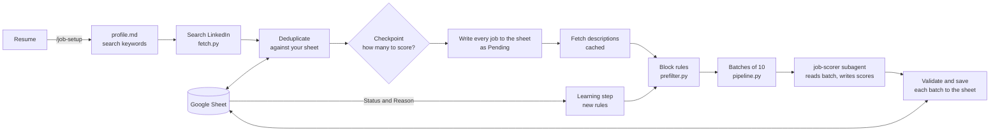

# Job Search Agent

[](LICENSE)
[](pyproject.toml)

An AI-assisted job search that runs on your own machine. It searches LinkedIn for roles that
match your resume, scores each new posting against your profile, and writes the results to a
Google Sheet in your own Drive, one row per job, never twice. Mark jobs in the sheet and it
learns what you do and don't want.

It is driven by [Claude Code](https://claude.com/claude-code) and runs only when you ask. There
is no server, no scheduler, and nothing is sent to the author.

## Quick start (no technical background needed)

You don't have to know git, Python or Google Cloud. Claude Code sets everything up for you and
asks plain questions along the way.

1. **Install** [VS Code](https://code.visualstudio.com/) and its **Claude Code** extension, and
   sign in with your Claude subscription.
2. **Get the project.** If you know git: `git clone https://github.com/JimmyMathew/job-search-ai-agent.git`.
   If not, open the repository page on GitHub, choose **Code → Download ZIP**, and unzip it
   somewhere you'll find again.
3. **Add your resume** (PDF, Word or text, any file name) to the `resume` folder inside the project.
4. **Open the project folder in VS Code**, open Claude Code, and type: **set me up**.

Claude installs what's missing, asks which city you want to search in, opens one Google
sign-in in your browser (pick your account and click *Continue*), creates your sheet, and shows
you the roles it found in your resume to approve. That's the whole setup, about ten minutes.

From then on, type `/job-run` in Claude Code whenever you want fresh jobs. You review them in
your Google Sheet. Details for everyone else follow below.

## Contents

- [Quick start (no technical background needed)](#quick-start-no-technical-background-needed)
- [Features](#features)
- [How it works](#how-it-works)
- [Requirements](#requirements)
- [Installation](#installation)
- [Getting started](#getting-started)
- [Usage](#usage)
- [Configuration](#configuration)
- [The Google Sheet](#the-google-sheet)
- [Cost and usage controls](#cost-and-usage-controls)
- [Privacy and security](#privacy-and-security)
- [Troubleshooting](#troubleshooting)
- [Project structure](#project-structure)
- [Development](#development)
- [Contributing](#contributing)
- [Disclaimer](#disclaimer)
- [License](#license)

## Features

- **Resume-driven.** Search terms, seniority and a candidate profile are derived from your
  resume. Nothing assumes a country, industry or language.
- **Each job exactly once.** New postings are deduplicated against everything already in your
  sheet, including reposts of the same role by the same company.
- **Nothing is hidden.** Every new job lands in the sheet. The AI score is a sort order with a
  one-line explanation, never a filter.
- **Learns from you.** Set a row's *Status* and *Reason*; repeated "Not for me" patterns become
  rules that rank similar jobs lower or skip them. Rules are plain text and editable in the sheet.
- **Resumable.** Scores are saved to the sheet batch by batch and descriptions are cached as they
  arrive. A crash, a closed laptop or a usage limit loses at most one batch, and the next run
  finishes what is left.
- **Cost-aware.** Job text never passes through the orchestrating session, runs are capped, and
  you see a usage estimate before anything is scored.
- **Private by design.** Your resume stays on your computer and the sheet lives in your own
  Google account. Each person has an isolated profile, sign-in and sheet.

## How it works



Only two steps involve a language model: the **learning** step (when you have changed a row's
Status or Reason) and **scoring**. Fetching, deduplication, rule matching, batching, validation
and all sheet I/O are deterministic Python in [`scripts/`](scripts), so they cost no tokens and
are covered by tests. The scorer is a Sonnet subagent that reads a batch file and writes a scores
file; the orchestrating session only ever sees one-line status messages.

## Requirements

- **Claude Code** with a Claude subscription, in [VS Code](https://code.visualstudio.com/) or a
  terminal. Scoring uses your own usage.
- **A Google account.**
- **[uv](https://docs.astral.sh/uv/)**, which provisions Python 3.12 and the dependencies.
  `/job-setup` installs it for you if it is missing. Plain Python 3.10+ with `pip` also works.
- A normal home internet connection. LinkedIn may rate-limit shared, VPN or corporate networks.

Developed and tested on Windows. macOS and Linux are expected to work but are less exercised.

## Installation

```bash
git clone https://github.com/JimmyMathew/job-search-ai-agent.git
cd job-search-ai-agent
```

Open the folder in VS Code and start Claude Code. Dependencies are installed by the setup step
below, or by hand:

```bash
uv sync
```

## Getting started

1. Put your resume (PDF, Word or text, any file name) in the [`resume/`](resume) folder.
2. In Claude Code, run `/job-setup` (or just say *set me up*, as in the quick start above).

Setup is a single idempotent command; run it again at any point and it resumes where it left
off. It will:

1. Install `uv` and the dependencies if needed.
2. Create your profile in `profiles/<name>/` from your resume.
3. Ask which locations to search, and optionally which roles.
4. Open **one** Google sign-in in your browser and create your sheet. The app requests only the
   `drive.file` scope: it can see and edit files it created itself, and nothing else in your
   Drive.
5. Write `profile.md` (skills, seniority, search keywords) and ask you to approve it.
6. Run a connectivity check, then offer a small first run.

Prefer to drive it by hand?

```bash
uv run python scripts/new_profile.py jane-doe --resume path/to/resume.pdf
uv run python scripts/sheet.py --profile jane-doe connect     # Google sign-in, creates the sheet
uv run python scripts/doctor.py --profile jane-doe            # readiness checklist
```

Then edit `profiles/jane-doe/config.yaml` and run `/job-setup jane-doe` to generate the profile.

## Usage

```text
/job-run <profile> [max-jobs-to-score]
```

A run searches for postings since the last run, deduplicates them, shows how many are new with a
usage estimate, and asks how many to score. Passing the number up front skips the question:

```text
/job-run jane-doe 20
```

If an earlier run was interrupted, the next one finishes the unscored rows first.

| Command | Purpose |
| --- | --- |
| `/job-setup [profile]` | Install, create a profile and sheet, generate `profile.md`. Safe to re-run. |
| `/job-run <profile> [cap]` | Search, deduplicate, score and write new jobs; learn from your feedback. |

Run `uv run python scripts/doctor.py --profile <name>` at any time for a checklist with the exact
fix for anything that is wrong.

## Configuration

Each profile has a `profiles/<name>/config.yaml`, created from
[`profiles/_example/config.yaml`](profiles/_example/config.yaml). Only `locations` is required.

| Key | Default | Description |
| --- | --- | --- |
| `locations` | *(required)* | One or more places to search, e.g. `"Berlin, Germany"`, `"Austin, TX"`, `"Remote"`. |
| `roles` | `[]` | Job titles to search for. If empty, roles are proposed from your resume at setup. |
| `explore_adjacent_roles` | `true` | Also consider related titles when proposing search keywords. |
| `max_jobs_to_score_per_run` | `60` | Suggested cap on jobs scored per run. You are asked before each run. |
| `first_run_max_jobs_to_score` | `30` | Smaller suggested cap for the very first run. |
| `first_run_hours_old` | `72` | How far back the first search looks, in hours. |
| `results_per_keyword` | `100` | Upper bound on results per keyword and location. |
| `description_max_words` | `1500` | Job descriptions are trimmed to this many words before scoring. |
| `auth` | `auto` | `auto`, `oauth` (Google sign-in) or `service_account`. |
| `sheet` | *(unset)* | Only for an existing sheet you made yourself; see below. |
| `credentials` | `secrets/service-account.json` | Service-account key path, for `service_account` mode. |

Per-profile state (the sheet that was created for you) is kept in `profiles/<name>/agent-state.json`.

**Using a sheet you already have.** The `drive.file` scope cannot open sheets the app did not
create. To use an existing one, set `sheet:` and provide a service-account key; see
[docs/service-account-setup.md](docs/service-account-setup.md).

## The Google Sheet

| Tab | Owner | Contents |
| --- | --- | --- |
| **Jobs** | You | Every new job: date, score, title, company, location, link, why it matches, gaps, flags, role type. You edit **Status** (dropdown) and **Reason**. |
| **Preferences** | You | Optional questions: minimum salary, work setup, work authorization, industries to prefer or avoid. A blank value means no preference. |
| `AI_Rules` | Agent | Learned rules (Block / Lower / Boost) with their evidence. Editable; rules you write yourself are never changed by the agent. |
| `AI_MetaData` | Agent | Run bookkeeping: last run time, counts, LinkedIn status. |
| `AI_StatusSync` | Agent | The Status and Reason the learning step last read, so each change is learned from once. |

A **Block** rule needs at least two similar "Not for me" rows behind it, so one bad day cannot
remove a whole category. Lower and Boost rules are ranking hints.

## Cost and usage controls

- Before scoring, the run reports how many new jobs it found and a rough usage estimate, then
  asks for a cap. Every new job is still added to the sheet whether or not it is scored.
- Block rules are applied to titles before descriptions are fetched, so capped slots are not
  spent on jobs you have already rejected.
- Descriptions are fetched only for jobs that will be scored, and each batch of 10 is scored in a
  fresh subagent call that reads its own input file.
- Searching LinkedIn costs no tokens but is rate-limited. If it reports being blocked, wait a few
  hours.

## Privacy and security

- Your resume and profile never leave your computer, apart from the text sent to Claude to be
  scored.
- Your sheet lives in your own Google account. The app's access is limited to files it created
  and can be revoked at <https://myaccount.google.com/permissions>.
- Your Google sign-in token is stored in `secrets/tokens/` on your computer only. `secrets/`,
  `profiles/` (except the `_example` template), `resume/` and `runs/` are git-ignored.
- `.claude/settings.json` pre-approves only this project's own scripts and denies Claude read
  access to `secrets/` and `.env`.
- The OAuth client file in `scripts/` identifies the app to Google. Desktop-app client secrets are
  not confidential.

## Troubleshooting

Start with `uv run python scripts/doctor.py --profile <name>`; each failure comes with its fix.

| Symptom | Resolution |
| --- | --- |
| "Google sign-in needed" | Run `/job-setup` again, or `uv run python scripts/sheet.py --profile <name> connect`. Safe to repeat; it never creates a second sheet. |
| "Couldn't reach Google" | Check your internet connection and retry. Your saved sign-in is fine. |
| 403 / 404 on your own sheet | See the table in [docs/service-account-setup.md](docs/service-account-setup.md). |
| "Blocked" or zero jobs found | LinkedIn rate-limited the connection. Wait a few hours; avoid VPNs and shared networks. |
| Rows stuck on *Pending* | A run was interrupted. Run `/job-run <name>` again; it finishes them first. |
| Missing packages | `uv sync`, or `pip install -r requirements.txt`. |

## Project structure

```text
.claude/
  commands/job-setup.md    # /job-setup: install, profile, Google sign-in, sheet
  commands/job-run.md      # /job-run: the search-score-learn cycle
  agents/job-scorer.md     # Sonnet subagent: reads a batch file, writes a scores file
  settings.json            # scoped permissions for this project's scripts
scripts/
  config.py                # profiles, config.yaml loading, validation, per-profile state
  google_auth.py           # OAuth sign-in (drive.file) and token refresh
  sheet.py                 # Google Sheets I/O and CLI
  sheet_schema.py          # sheet layout and the pure logic around it
  fetch.py                 # LinkedIn search and descriptions (JobSpy), checkpointed
  prefilter.py             # Block rules as whole-word keyword checks
  pipeline.py              # planning, batching, ingesting scores, crash recovery
  doctor.py                # readiness checklist
  new_profile.py           # create a profile from the template
  util.py                  # JSON and time helpers, job IDs, repost detection
profiles/_example/         # tracked template; real profiles are git-ignored
resume/                    # drop your resume here (git-ignored)
tests/                     # pytest suite; no network or Google account needed
docs/                      # maintainer and advanced-setup guides
```

[`CLAUDE.md`](CLAUDE.md) documents the design decisions and conventions in more depth.

## Development

```bash
uv sync                                   # dependencies, plus pytest and ruff
uv run pytest                             # unit tests
uv run ruff check scripts tests           # lint
uv run ruff format --check scripts tests  # formatting
```

The tests cover config validation, sheet layout and row mapping, feedback diffing, the pipeline's
planning, batching and retry logic, score validation, the prefilter and the Google auth flow, all
against in-memory fakes.

Maintainers: the one-time Google Cloud setup behind the sign-in is described in
[docs/maintainer-oauth-client.md](docs/maintainer-oauth-client.md).

## Contributing

Issues and pull requests are welcome. Please run the tests and linters above before opening a
pull request, and keep person-, country- and industry-specific assumptions out of code and
prompts. Ideas not yet built: additional job sources beside LinkedIn, and a scoring step usable
from other agent CLIs.

## Disclaimer

This project is not affiliated with LinkedIn. LinkedIn's terms restrict automated access. The
tool makes low-volume, logged-out searches for personal use, but you use it at your own risk, for
example your connection may be temporarily blocked. Do not run it while logged in, from a shared
or work network, or on a server.

## License

[MIT](LICENSE)
